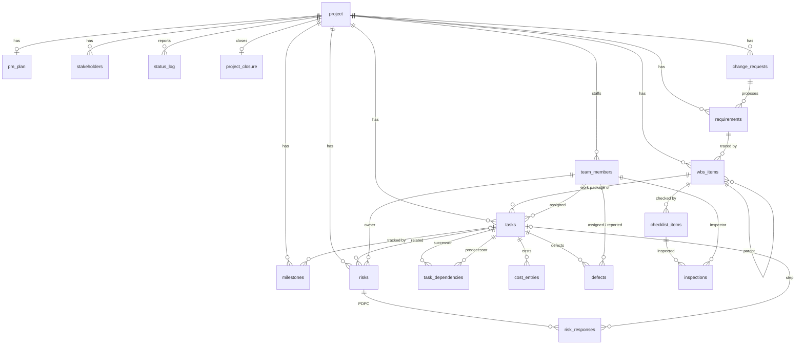

# Database

SQLite database `healthcare.db`, created by `npm run db:init` from [`db/schema.sql`](../db/schema.sql) (tables, views, triggers) and [`db/seed.sql`](../db/seed.sql) (the sample project). Conventions:

- Dates are ISO text `YYYY-MM-DD`, validated with `date(col) IS col`.
- Money is whole PKR (`INTEGER`).
- Durations are inclusive calendar days: `end = start + duration - 1`.
- `project.status_date` is "today" for every schedule, cost and quality calculation.
- Foreign keys are on for every connection (`PRAGMA foreign_keys = ON`).

## Tables

| Module | Table | Purpose |
|--------|-------|---------|
| 1 Initiation | `project` | Charter: objectives, scope in/out, start, original and current deadline, original and current budget, status date, phase, EVM alert thresholds |
| 1 | `pm_plan` | Project management plan (scope, schedule, cost, quality plans), one per project |
| 1 | `stakeholders` | Stakeholder register with influence and interest |
| 1 | `team_members` | Project team and roles; assignees, owners, inspectors |
| 1 | `milestones` | Milestones, optionally tracking a task's finish; status Pending / At Risk / Achieved / Missed |
| 1 | `status_log` | Weekly status reports (Green / Amber / Red) |
| 1 | `project_closure` | Closure record: acceptance, final cost, lessons learned, sign-off |
| 2 Scope | `requirements` | Requirements register (Proposed / Approved / Rejected / Deferred), optionally belonging to a change request |
| 2 | `wbs_items` | WBS tree: Project → Deliverable → Work Package; a work package can trace to a requirement |
| 2 | `change_requests` | Change control: justification, cost impact, schedule impact, decision |
| 3 Schedule | `tasks` | Activities on work packages: assignee, duration, planned and actual dates, % complete, status, estimate (BAC share) |
| 3 | `task_dependencies` | Finish-to-start links with lag days |
| 4 Cost | `cost_entries` | Actual expenditure per task, dated and categorised (Labor / Infrastructure / Licensing / Other) |
| 5 Quality | `defects` | Defects tied to a task (and through its WBS item to a requirement): severity, status, owner |
| 5 | `checklist_items` | Quality criteria per deliverable or work package |
| 5 | `inspections` | Inspection and test results per checklist item (Pass / Fail / Pending) |
| 5 Risk | `risks` | Risk register; `score` = likelihood × impact and `rating` are GENERATED columns |
| 5 | `risk_responses` | PDPC rows: step (task) → potential problem → preventive or corrective countermeasure |
| 6 | `audit_log` | Automatic record of change-request decisions |

Views: `v_task_actual_cost` (AC per task), `v_risk_ranked` (open risks ranked by score then impact; ties share a rank), `v_unresolved_critical_defects`.

## ER diagram

## Business rules enforced by the database

| Rule | Mechanism |
|------|-----------|
| Dates are valid ISO dates; budgets > 0; durations ≥ 1; money ≥ 0 or > 0 | CHECK on each column |
| Deadline and original deadline are not before the start date; 0 < critical threshold ≤ warning threshold | CHECK on `project` |
| A Deliverable sits directly under the Project node; a Work Package directly under a Deliverable | `trg_wbs_rules_ins/upd` |
| **Scope rule:** only APPROVED requirements can be placed in the WBS | `trg_wbs_rules_ins/upd` |
| **Scope rule:** a requirement belonging to a change request can only become Approved when that CR is approved | `trg_req_cr_gate_ins/upd` |
| An approved requirement already in the WBS cannot be un-approved | `trg_req_in_use` |
| A new change request starts Pending; a decided CR is final; a decision needs a date and a decision maker | `trg_cr_starts_pending`, `trg_cr_final`, `trg_cr_needs_decision` |
| **Approving a CR** raises the current budget, moves the deadline, approves its requirements and writes the audit log (one transaction) | `trg_cr_approved` |
| Rejecting a CR rejects its proposed requirements and logs it | `trg_cr_rejected` |
| Tasks must be attached to a Work Package and cannot start before the project | `trg_task_rules_ins/upd` |
| Duration matches the planned dates (inclusive calendar days) | CHECK on `tasks` |
| Status, % complete and actual dates agree (Not Started = 0% and no actual dates; In Progress / On Hold = 0-99% with an actual start; Completed = 100% with both actual dates, end ≥ start) | CHECK on `tasks` |
| **Budget rule:** total task estimates ≤ current approved budget | `trg_task_budget_ins/upd` |
| The budget cannot be lowered below the existing task estimates | `trg_project_budget_floor` |
| No circular dependencies; a task cannot depend on itself; only finish-to-start; lag ≥ 0 | `trg_dep_no_cycle` + CHECKs on `task_dependencies` |
| Actual cost cannot be booked on a task that has not started | `trg_cost_task_started` |
| Defect resolved date is set exactly when Resolved/Closed and is not before the reported date | CHECKs on `defects` |
| Milestone actual date is set exactly when Achieved | CHECK on `milestones` |
| Likelihood and impact are 1-5; score and rating are computed by the DB | CHECK + GENERATED columns on `risks` |
| The project cannot be closed while tasks are incomplete or critical defects are unresolved | `trg_project_close_gate` |

The application adds server-side validation on top (e.g. a cost entry cannot be dated after the status date, and thresholds must satisfy 0 < critical ≤ warning ≤ 1.5). The `/integrity` page re-checks cross-module consistency on live data (13 checks).
